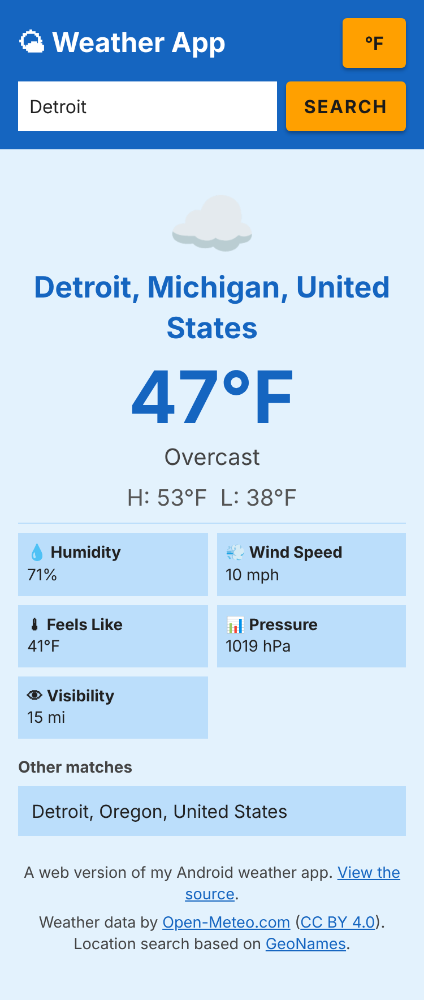

# Weather App

Search any city for its current weather: temperature, conditions, humidity, wind, pressure, visibility and the day's high and low, in Fahrenheit or Celsius. Built twice: as an **Android app** (Kotlin) and as a **web version** (JavaScript) you can use right in the browser.

**Try it:** https://mberry-dev.github.io/weather-app/



Built for CIS 436 (Mobile Application Development) at the University of Michigan-Dearborn, then extended with a web version.

| | Android app | Web version |
| --- | --- | --- |
| Weather data | [OpenWeatherMap](https://openweathermap.org/api) (needs a free API key) | [Open-Meteo](https://open-meteo.com) (no key needed) |
| Language | Kotlin | JavaScript, no framework or build step |
| Tests | Written test plan on 3 Pixel emulator profiles, unit tests for the number formatting, and a build check on every change | 60 automated tests, plus a live check of the weather service |

The two versions are built to behave the same: the same layout and colors, the same units and rounding, the same messages, same-name city matches, and a remembered last city and unit. The only differences come from the two weather services: the wording of the conditions ("Scattered clouds" or "Overcast"), the weather icons, and sometimes the exact high and low. The web version uses a different service on purpose. A web page's code is public, so an API key placed in it would be visible to everyone. Open-Meteo needs no key, so there is no secret to leak.

## Web version

- Search by city name, with the Enter key or the button
- Shows the place with its region and country, a weather icon and description, temperature, feels-like, today's high and low, humidity, wind, pressure and visibility
- **°F / °C toggle** that converts on the page without asking the weather service again. Fahrenheit shows wind in mph and visibility in miles; Celsius shows km/h and km.
- **Same-name cities:** if a search matches several places (Detroit, Michigan and Detroit, Oregon), the best match is shown and the others are one click away
- Remembers your unit and last city in the browser
- Clear messages for an empty search, a city that isn't found, being offline, and unreadable data
- A loading spinner, and a newer search always wins over an older, slower one
- Works on phones and desktops, and with a keyboard and screen readers (it has no accessibility violations in an automated check)

### Run it locally

You need [Node.js](https://nodejs.org) 20 or newer. The page uses JavaScript modules, which browsers won't load from a file opened directly, so serve the folder:

```bash
cd web
npm install
npm start
```

Then open the address it prints in your browser (usually `http://localhost:3000`). It only works while the command above is running on your own computer. The page loads weather from Open-Meteo, so you need an internet connection.

### Tests

60 automated tests with Node's built-in test runner:

- **Weather logic** (24): temperature, wind and visibility conversions, every weather code, the request URLs, and reading the weather service's responses, including missing or malformed data
- **Weather service client** (12): successful lookups, no results, being offline, server errors, invalid responses, cancelled requests, and special characters in city names
- **Interface** (24): the page is loaded in a simulated browser to check searching, errors, the unit toggle, other matches, saving to the browser, out-of-order responses, and that place names from the service can't inject markup

```bash
cd web
npm install
npm test
```

A separate **live check** calls the real Open-Meteo services and confirms they still answer the way the page expects, including that they allow requests from a web page. It runs on every change and weekly on GitHub, and doesn't block a deploy because the service is outside my control:

```bash
npm run check:api
```

### Credits

Weather data by [Open-Meteo.com](https://open-meteo.com/) under [CC BY 4.0](https://creativecommons.org/licenses/by/4.0/). Location search is based on [GeoNames](https://www.geonames.org/). Open-Meteo's free service is for non-commercial use.

## Android version

### Features

- Search by city name, with the keyboard's search key or the button
- Shows temperature, feels-like, a weather icon and description, humidity, wind speed, pressure, visibility, and the day's high and low
- Toggle between Fahrenheit and Celsius. Fahrenheit shows wind in mph and visibility in miles; Celsius shows km/h and km. Numbers are rounded, not cut off.
- **Same-name cities:** if a search matches several places (Detroit, Michigan and Detroit, Oregon), the best match is shown and the others are one tap away
- Remembers your unit and last city between launches
- Clear messages for an empty search, a city that isn't found, an invalid key, and network problems
- A loading spinner, and a newer search always wins over an older, slower one
- Survives screen rotation: the weather, the unit and the last city stay put without asking the API again

### How it's built

- Two fragments in one activity: `TopFragment` (search bar and unit toggle) and `BottomFragment` (the weather display)
- `WeatherViewModel` with LiveData does the searching and keeps the state across rotation, so the two fragments share data and nothing is refetched. It saves the unit and last city in `SharedPreferences`.
- `WeatherFormat` holds the rules for showing numbers (units, rounding, place names) with no Android code in it, so it has unit tests
- [Volley](https://developer.android.com/training/volley) for the HTTP requests (OpenWeatherMap's geocoding, then current weather), and [Glide](https://github.com/bumptech/glide) for the weather icons
- The API key is read from a git-ignored file at build time and exposed to the app as `BuildConfig.WEATHER_API_KEY`, so it is never committed

### Run it

You need a current, stable version of [Android Studio](https://developer.android.com/studio). The project uses Android Gradle Plugin 9.0 and Gradle 9.1, so an older Android Studio may ask you to update before it will open the project.

1. Get a free API key: create an account at [openweathermap.org](https://home.openweathermap.org/users/sign_up), then copy the key from the **API keys** page. A new key can take a little while to start working.
2. Clone the repo:
   ```bash
   git clone https://github.com/mberry-dev/weather-app.git
   ```
3. In Android Studio choose **Open** and select the `WeatherApp` folder inside the repo. Let Gradle finish syncing. The first sync downloads Gradle and the Java version the project needs, so it needs an internet connection and can take a few minutes.
4. Add your key to the file `WeatherApp/local.properties`, which Android Studio creates for you and Git ignores. Add this line to it (keep the existing `sdk.dir` line), then sync again:
   ```
   WEATHER_API_KEY=your_key_here
   ```
5. Run the app on an emulator or a connected phone (Android 7.0 / API 24 or newer).

Without a key the app still opens, but every search shows "Invalid API key", and Gradle prints a warning when it syncs.

**If searches say "Invalid API key":** a brand-new key can take from a few minutes to a couple of hours to start working, so wait and search again. If it still fails, check that the line in `local.properties` is exactly `WEATHER_API_KEY=your_key` with no quotes or spaces, then sync Gradle again.

### Testing

Every change that touches the Android code is also built on GitHub. That check confirms the project builds with no key, with a key in `local.properties`, and with a key in an environment variable, and that no key is committed to the repo.

The number formatting has unit tests (`WeatherFormatTest`) that use the same values as the web version's tests, so the two apps can't drift apart. Run them with:

```bash
cd WeatherApp
./gradlew testDebugUnitTest      # Git Bash: as shown. PowerShell: .\gradlew.bat testDebugUnitTest
```

I also tested the app on three Pixel emulator profiles (Pixel 2, Pixel 4 and Pixel 7) with a written test plan: [`WeatherApp/WeatherApp_TestPlan.xlsx`](WeatherApp/WeatherApp_TestPlan.xlsx). It has 32 test cases over three days (startup and UI, the API and weather data, and rotation), and each one was run on all three devices.

The project description with screenshots is in [`WeatherApp/WeatherApp_Description.docx`](WeatherApp/WeatherApp_Description.docx). The test plan and description were written for the original course version of the app, before it was updated to match the web version (units, same-name matches and the remembered city).

## Project structure

```
weather-app/
├── web/                           # Web version
│   ├── index.html, style.css
│   ├── src/
│   │   ├── weather.js             # Units, weather codes, URLs, reading responses
│   │   ├── api.js                 # Talks to Open-Meteo
│   │   ├── ui.js                  # Builds the page and handles input
│   │   └── main.js                # Starts the page
│   ├── tests/                     # Unit and interface tests, with sample responses
│   └── scripts/check-api.js       # Live check of the weather service
├── docs/web-screenshot.png        # Screenshot used in this README
├── WeatherApp/                    # Android version
│   ├── WeatherApp_TestPlan.xlsx
│   ├── WeatherApp_Description.docx
│   └── app/src/
│       ├── main/
│       │   ├── java/com/example/weatherapp/
│       │   │   ├── MainActivity.kt        # Hosts the two fragments
│       │   │   ├── TopFragment.kt         # Search bar and unit toggle
│       │   │   ├── BottomFragment.kt      # Weather display and other matches
│       │   │   ├── WeatherViewModel.kt    # Searching, saved city and unit, state kept across rotation
│       │   │   ├── WeatherFormat.kt       # Units, rounding, messages, place names
│       │   │   └── WeatherData.kt         # The weather and place data models
│       │   └── res/                       # Layouts (portrait and landscape), strings, colors
│       └── test/                          # Unit tests for WeatherFormat
└── .github/workflows/
    ├── web.yml                    # Runs the tests and live check, publishes the site
    └── android.yml                # Builds the Android app and checks the key setup
```
